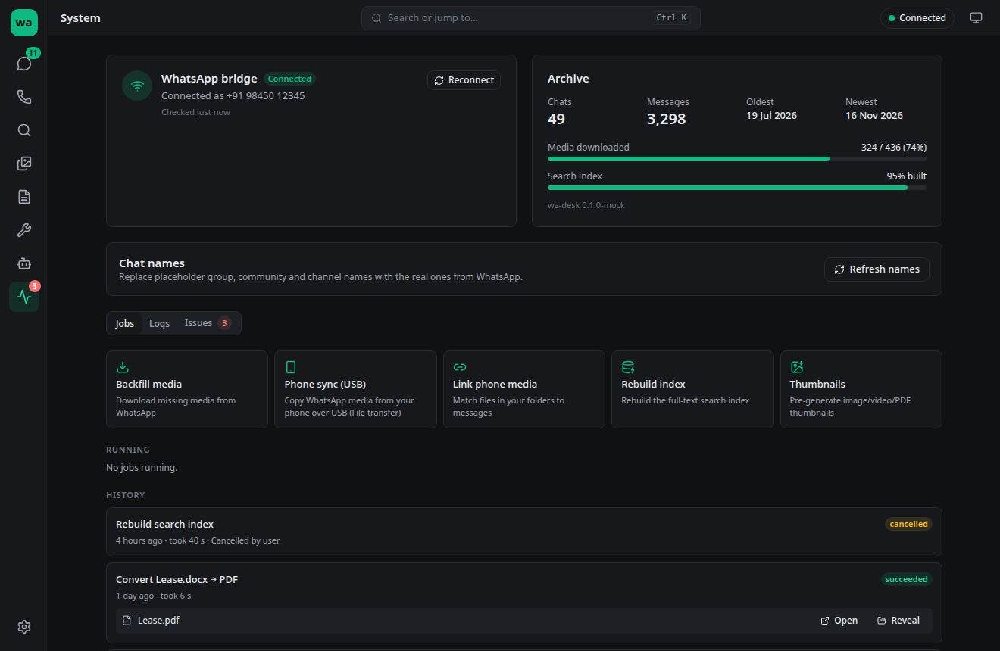

# wa-desk

A local desktop app (Rust + Tauri v2) on top of your own WhatsApp bridge. It reads the bridge's message archive and gives you a fast, searchable client for it.

- **Chats**: browse, reply, react, attach, send.
- **Search**: full-text search across the whole archive.
- **Media and Docs**: gallery, lightbox, and an in-app viewer with PDF and Office preview.
- **Tools**: file converters.
- **Automations**: rules that react to incoming messages (off by default).
- **System**: dashboard with bridge status, jobs, logs and issue reports.

Everything runs on your machine. wa-desk talks only to the bridge on `127.0.0.1:8080`.

## Screenshots

| Chats | System |
|---|---|
|  |  |

| Docs | Search |
|---|---|
|  |  |

More in [`app/ui/screenshots/`](app/ui/screenshots/): media, tools, automations and settings, each in light and dark.

## Install and launch

Build the packages (from the repo root):

```bash
cd app/src-tauri
cargo tauri build -b deb          # add ",appimage" if linuxdeploy works on your machine
sudo apt install ../../target/release/bundle/deb/wa-desk_0.1.0_amd64.deb
```

The `.deb` depends on `libwebkit2gtk-4.1-0` and `libayatana-appindicator3-1`. It installs `/usr/bin/wa-desk`, a `.desktop` entry and icons.

Launch from the app menu or run `wa-desk`.

| Command | Effect |
|---|---|
| `wa-desk` | Opens the window. |
| `wa-desk --hidden` | Starts in the tray with no window. Autostart uses this flag. |

- Only one instance runs. Starting a second one focuses the first.
- Closing the window **hides it to the tray**. Use **Quit wa-desk** in the tray menu to exit.
- Tray menu: *Show / Hide wa-desk*, *Pause automations*, *Quit wa-desk*.
- Settings has "Start wa-desk when I log in" (autostart) and "Start hidden in the tray".

## Bundled bridge

Release builds ship the WhatsApp bridge (the Go program from the `bridge/` submodule) as a sidecar named `wa-bridge`, next to the `wa-desk` executable. wa-desk starts and supervises it, so there is nothing to install separately.

- **What runs.** At startup wa-desk checks the bridge URL (`http://127.0.0.1:8080` by default). If a bridge already answers there, for example your own `whatsapp-bridge.service`, wa-desk leaves it alone. Otherwise it starts `wa-bridge` in the background (the window never waits for it).
- **Never two bridges on one store.** Before starting the bridge, wa-desk takes an exclusive lock on `<data dir>/whatsapp-mcp/runtime/.wa-desk-bridge.lock`, held while the bridge runs. If the lock is taken, wa-desk does not start one (state "external"; in `bundled` mode it reports an error instead). In `auto` mode wa-desk also treats the bridge as external, and never starts one, when the systemd user unit `whatsapp-bridge.service` is enabled or active (Linux), even if the port is not answering yet. It also probes the port 3 times over about 6 seconds before deciding that no bridge is running, so a bridge that is still starting is noticed. If the bundled bridge exits and another bridge now answers on the port (or the lock cannot be retaken), wa-desk stops restarting it and switches to "external".
- **Where data lives.** The bridge runs with working directory `<data dir>/whatsapp-mcp/runtime` (created owner-only), so it uses the same `store/` that wa-desk reads: `~/.local/share/whatsapp-mcp/runtime/store/` on Linux. An existing store keeps working.
- **Environment.** `WHATSAPP_BRIDGE_PORT` (from the bridge URL), `WEBHOOK_ENABLED=false`, `WHATSAPP_DEVICE_NAME=wa-desk`.
- **Pairing.** On a fresh store, open **System**, where the bridge card shows the QR code. Scan it from WhatsApp, Linked devices.
- **Restarts.** If it exits unexpectedly it is restarted after 1 s, 2 s, 5 s and so on, up to 60 s. After repeated fast crashes wa-desk gives up and records an issue.
- **Quit.** **Quit wa-desk** in the tray menu stops the bridge. Closing the window only hides it, so the bridge keeps running.
- **Log.** `bridge.log` in the logs folder (`~/.local/state/wa-desk/logs/`), rotated at 5 MB. The auth token and pairing QR art are never written to it.
- **Setting `bridge_mode`** (Settings, "WhatsApp bridge"; applied at the next start):
  - `auto` (default): use a running bridge, else start the bundled one.
  - `external`: never start a bridge. Pick this if you run the bridge yourself, so two bridges never share one store.
  - `bundled`: always start the bundled bridge; reports an error if the port is already in use.
- The System view's bridge card shows the state: running (with pid), external, not installed (builds without the sidecar, such as `cargo tauri dev`), crashed or gave up.
- A bridge URL that does not point at this computer is never started for.
- `WA_DESK_BRIDGE_BIN` overrides the sidecar path (development).

## MCP server

wa-desk can run an MCP (Model Context Protocol) server, so AI assistants that support MCP can read and send your WhatsApp messages. It is the Python server from the `bridge/whatsapp-mcp-server` submodule. It is **on by default** and local-only (it listens on `127.0.0.1`). Turn it off in Settings, "MCP server", if you don't use it.

- **URL.** `http://127.0.0.1:8771/mcp` (streamable HTTP). Settings shows the URL with a copy button; the port is configurable.
- **Point a client at it.** In your MCP client's configuration, add a server of type "streamable HTTP" (some clients call it "http") with that URL. No token or credentials are needed on your side. Clients that only speak stdio need a stdio-to-HTTP proxy.
- **Needs `uv`.** The server runs with [uv](https://docs.astral.sh/uv/), which wa-desk looks for on `PATH`, then in `~/.local/bin` and `~/.cargo/bin` (on Windows `%USERPROFILE%\.local\bin` and `%USERPROFILE%\.cargo\bin`). wa-desk never installs anything itself: if `uv` is missing, Settings and System say "Needs uv". uv may also download a suitable Python if the system has none.
- **First run.** The first start creates a Python environment and installs the server's dependencies (needs network, can take a minute). The status shows "Starting (first run installs dependencies)". The environment lives in the app cache (`~/.cache/wa-desk/mcp-venv/` on Linux), so the install folder can stay read-only.
- **Applies immediately.** Changing the switch or the port starts, stops or restarts the server at once; no relaunch is needed.
- **Never two on one port.** If an MCP server already answers on the port (for example one you run yourself), wa-desk uses it and starts nothing ("external"). If another program holds the port, the state is "port in use"; pick another port.
- **Restarts.** If it exits unexpectedly it is restarted after 1 s, 2 s, 5 s and so on, up to 60 s. After repeated fast crashes wa-desk gives up and records an issue.
- **Quit.** **Quit wa-desk** stops it, and so does turning it off. Closing the window only hides it to the tray, so it keeps running.
- **Log.** `mcp.log` in the logs folder, rotated at 5 MB. Message text and the bridge token are not written by wa-desk; the server reads the token from the bridge store itself.
- **What it can do.** Whatever you allow an MCP client to do with it: read chats and messages, and send messages and files through the bridge. Only connect clients you trust.
- Development: `WA_DESK_MCP_DIR` overrides the server source folder; otherwise debug builds use `bridge/whatsapp-mcp-server` in the checkout.

## First run

The search index is built once, in the background. For about 115k messages this takes roughly 10 seconds. Chats and media work meanwhile. Search becomes available when the index is ready. After that the index is updated live as messages arrive.

## Views and shortcuts

| Shortcut | Action |
|---|---|
| `Ctrl+K` | Command palette: jump to a chat or view, run actions |
| `Ctrl+F` | Open Search (focuses the query box) |
| `Alt+1` ... `Alt+8` | Chats, Search, Media, Docs, Tools, Automations, System, Settings |
| `Esc` | Close the topmost overlay or palette; cancel a reply in the composer |
| `Enter` / `Shift+Enter` | Send / new line in the composer |
| `Up` / `Down` | Move through the chat list, palette and pickers |
| `Ctrl+=` / `Ctrl++` / `Ctrl+Shift+=` / numpad `+`, `Ctrl+-` / numpad `-`, `Ctrl+0` | Zoom the whole app in / out / back to 100% (50% to 200%, browser-like steps; `Ctrl`+mouse wheel works too; remembered across restarts) |
| `Ctrl+V` | In a chat: attach an image or file from the clipboard (screenshots, images copied in a browser, files copied in the file manager) |
| `Left` / `Right`, `+` / `-`, `0` | Lightbox: previous/next, zoom in/out, reset zoom |

In the lightbox, plain `+` / `-` / `0` zoom the picture; with `Ctrl` they zoom the app.

`Ctrl+F` and `Alt+n` are ignored while a dialog or lightbox is open. `Cmd` works like `Ctrl`.

- **Chats**: chat list and thread with the newest messages first, older pages on scroll. Reply, react, mark read. Attach several files at once (attach button, drag and drop, or paste): a tray lists every file and each can be removed; they are sent one after another, with your text as the caption of the first file, and a failed file gets a Retry without stopping the rest. Right-click an image (or use the viewer's button) for **Copy image**, which puts the picture itself on the clipboard. Confirmation before sending to groups or with attachments can be switched off in Settings.
- **Search**: full-text search with filters (chat, sender, date). Results jump to the message in context. After a jump, use **Jump to latest** to return to the newest messages.
- **Media**: grid of photos, video, audio and stickers with thumbnails and a lightbox. Open with the system app or Save as.
- **Docs**: all documents. PDFs render in-app (page navigation); Office files (docx, xlsx, pptx, odt, ...) are converted to PDF with LibreOffice and cached.
- **Tools**: Office to PDF, compress image, compress video, compress PDF (Ghostscript), audio to Opus, PDF to images. Inputs can be local files or downloaded WhatsApp media. Results go to `~/Downloads/wa-desk`.
- **Automations**: rules with triggers and actions (reply, download media, notify, forward, tag, webhook). Test a rule against a sample message before enabling. A fired-rule log is shown.
- **System**: bridge connection and reconnect, overview counts, jobs (backfill, phone sync, phone-media linking, conversions, thumbnails) with progress and cancel, a log viewer, and issues that can be resolved or exported as a redacted zip.
- **Settings**: theme, autostart, notifications, send confirmation, hourly automation rate, backfill window, extra folders for phone-media linking.

## Safety model

The bridge owns the live databases. wa-desk is built so it cannot disturb it.

- **Read-only DB access.** `messages.db` and `whatsapp.db` are opened with `mode=ro`, `busy_timeout` of 2 s or less, paged reads (500 rows or fewer), and a per-query deadline of about 300 ms. No transaction spans an `await`. The only write to a bridge DB is mirroring `phone_media_links`, in short transactions.
- **Token stays in Rust.** `.bridge-token` and the `*.db*` files are never read, logged or served to the UI. All bridge HTTP happens in the Rust backend.
- **Scoped media protocol.** The `wa-media://` handler resolves every path inside the bridge store, phone-media, exports or cache folders (`resolve_within`) and rejects anything else. Range requests are supported. `open_path` and `reveal_path` are limited to the exports and cache folders.
- **Strict CSP**, frozen prototypes, loopback-only bridge URL.
- **Logs are redacted**: tokens, phone numbers (last 4 digits kept) and home paths are scrubbed. Message text is not logged at info level.
- **Automations are conservative.**
  - Off by default. The master switch must be turned on explicitly.
  - Rules are created in dry-run mode by default: they log what they would do and send nothing.
  - Enabling sets a watermark, so old messages never fire, and a message must be under 10 minutes old.
  - Groups need explicit opt-in per rule, and replies there only happen when you are @mentioned.
  - Own messages, reactions, deleted messages and status updates are ignored.
  - Per-rule-per-chat cooldown plus a global hourly send cap.
  - Tray "Pause automations" stops all of it immediately.
- **`WA_DESK_READ_ONLY=1`** disables sends, reactions, read receipts and automations.

## Data locations

| Path | Contents |
|---|---|
| `~/.local/share/whatsapp-mcp/runtime/store/` | Bridge DBs and token (read-only for wa-desk) |
| `~/.local/share/wa-desk/app.db` | Settings, search index, rules, job history |
| `~/.local/share/wa-desk/obs.db` | Issues |
| `~/.cache/wa-desk/` | Thumbnails and Office-to-PDF previews (safe to delete) |
| `~/.local/state/wa-desk/logs/*.jsonl` | Daily JSON logs, 7 kept |
| `~/Downloads/wa-desk/` | Exports: conversions, saved media, issue bundles |

Paths follow the XDG directories on your system.

### Environment variables

| Variable | Effect |
|---|---|
| `WA_DESK_DATA_ROOT` | Put everything under one root (`whatsapp-mcp/`, `wa-desk/`, `exports/`). Use it to run against a copy of the data. |
| `WA_DESK_READ_ONLY=1` | Disable all sends, reactions, receipts and automations |
| `WA_DESK_LOG` | Log filter, `tracing` `EnvFilter` syntax, e.g. `wa_desk_lib=debug` |
| `WA_DESK_BRIDGE_URL` | Bridge base URL (default `http://127.0.0.1:8080`) |
| `WA_DESK_MCP_DIR` | Folder of the MCP server source (default: bundled with release builds, `bridge/whatsapp-mcp-server` in a development checkout) |
| `WA_DESK_BRIDGE_BIN` | Path of the bundled bridge binary (default: `wa-bridge` next to the executable) |
| `WEBKIT_DISABLE_DMABUF_RENDERER` | Set to `1` by the app unless already set (see Troubleshooting) |

## Architecture

```
            app/ui (Svelte, TypeScript)
               |  invoke / events        wa-media:// (thumbnails, files, previews)
               v                              |
        app/src-tauri  (commands, protocol, tray, background loops)
               |
          AppCore  (Tauri-independent, tested)
     +---------+----------+-----------+-------------+
     |         |          |           |             |
   wa-db   wa-bridge   wa-jobs   wa-automation   wa-obs
 (RO bridge  (REST +   (backfill,  (rule engine)  (logs, issues,
  DBs, index, outbox)  convert,                    redaction)
  app.db)              thumbs)
     \_________\__________|___________/_____________/
                    wa-core  (types, errors, paths, config, traits)
                    wa-testkit (fixtures, dev-only)
```

| Crate / dir | Role |
|---|---|
| `crates/wa-core` | Shared contract: domain types (exported to TypeScript), error type, time parsing, path rules, config, traits |
| `crates/wa-db` | Read-only bridge DB access, name resolution, queries, `app.db`, search index, change watcher |
| `crates/wa-bridge` | HTTP client for the bridge (token, Host check) and outbox staging |
| `crates/wa-jobs` | Backfill, phone sync, phone-media linker, conversions, thumbnails, Office previews |
| `crates/wa-automation` | Rule engine with loop, rate and group guards |
| `crates/wa-obs` | Structured logging, redaction, issue store, report bundles |
| `crates/wa-testkit` | Fixture that mirrors the real install layout, with edge cases seeded |
| `app/src-tauri` | Tauri shell: commands, `wa-media` protocol, tray, background loops |
| `app/ui` | Svelte UI, Vitest unit tests, Playwright e2e |

The IPC surface is documented in [`docs/CONTRACT.md`](docs/CONTRACT.md). Contributor rules are in [`CONTRIBUTING.md`](CONTRIBUTING.md).

## Development

Requirements: Rust (stable), Node 20+, the Tauri v2 prerequisites for Linux (webkit2gtk 4.1, libayatana-appindicator), `cargo-tauri`, `cargo-nextest`. LibreOffice and Ghostscript are needed for Office previews and PDF compression.

```bash
cd app/ui && npm install
npm run dev                       # UI alone against built-in mock data (no backend needed)

cd app/src-tauri && cargo tauri dev           # whole app
WA_DESK_DATA_ROOT=/tmp/wa-copy cargo tauri dev   # whole app against a copy of the data

scripts/check.sh                  # full gate: fmt, clippy, tests, bindings, UI check/test/build, e2e
E2E=0 scripts/check.sh            # same without Playwright
```

Tests: about 350 Rust (`cargo nextest run --workspace`), 120 UI unit (Vitest), 27 Playwright e2e.

TypeScript bindings in `app/ui/src/lib/bindings/` are generated by `cargo test -p wa-core`. The gate fails if they are stale.

## Troubleshooting

- **Blank or black window (NVIDIA, Wayland).** wa-desk already sets `WEBKIT_DISABLE_DMABUF_RENDERER=1` at startup. If it is still blank, try `GDK_BACKEND=x11 wa-desk`.
- **No tray icon on GNOME.** Install and enable the AppIndicator extension (`gnome-shell-extension-appindicator`). Without a tray, closing the window still hides it; start `wa-desk` again to bring it back.
- **Bridge offline.** The System view shows the state. Check `systemctl --user status whatsapp-bridge`. If the session is not paired, check `whatsapp-login`. Use **Reconnect** in System afterwards.
- **Phone media sync.** Connect the phone by USB in **File transfer** mode, then run **Link phone media** from System.
- **"database is locked".** This is never expected. wa-desk uses read-only handles with short deadlines. If you see it, look at `journalctl --user -u whatsapp-bridge` and the wa-desk logs, then export an issue bundle from System.
- **Logs.** `~/.local/state/wa-desk/logs/`, or the System view. Run with `WA_DESK_LOG=debug` for more detail.

## Known limitations

- The search index build can only be cancelled before it starts.
- The tray "Pause automations" state is not persisted across restarts.
- Mention detection for group automations matches by phone number only.
- Edits and revokes older than 48 hours are picked up by the reconcile pass, which runs every 6 hours.
- After jumping to an old message from search, newer messages do not page in; use **Jump to latest**.
- The AppImage target needs `linuxdeploy` (and FUSE) to work on the build machine. The `.deb` is the supported package.
- Linux only.
