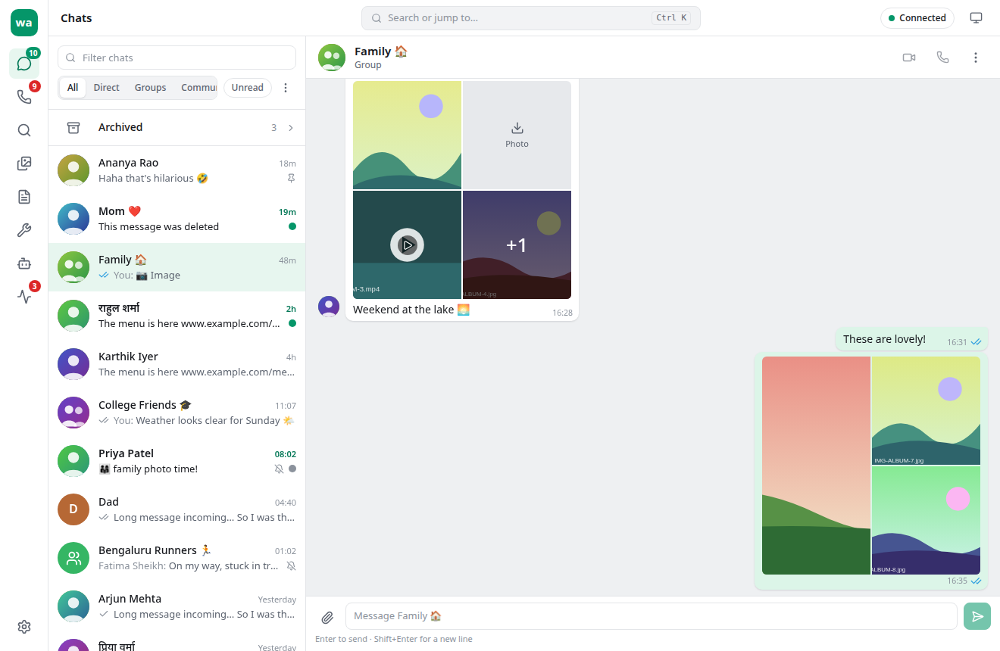
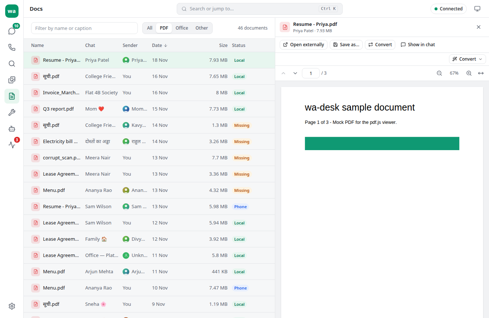
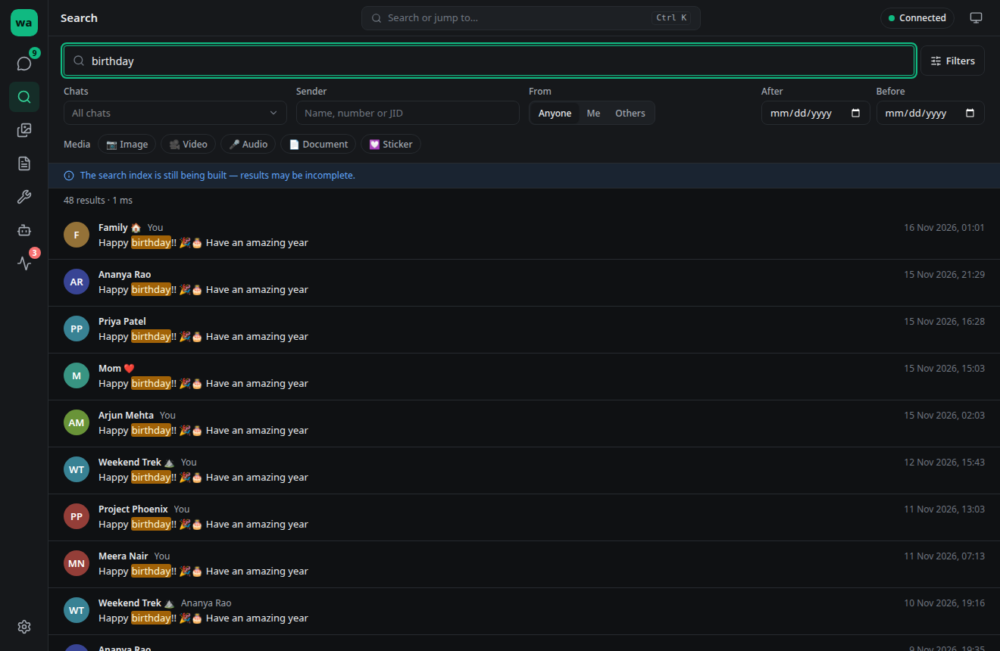

# wa-desk

A local desktop app (Rust + Tauri v2) on top of your own WhatsApp bridge. It reads the bridge's message archive and gives you a fast, searchable client for it.

- **Chats**: browse, reply, react, attach, send.
- **Search**: full-text search across the whole archive.
- **Media and Docs**: gallery, lightbox, and an in-app viewer with PDF and Office preview.
- **Tools**: file converters.
- **Automations**: rules that react to incoming messages (off by default).
- **System**: dashboard with bridge status, jobs, logs and issue reports.

Everything runs on your machine. wa-desk talks only to the bridge on `127.0.0.1:8080`.

## Screenshots

| Chats | System |
|---|---|
|  |  |

| Docs | Search |
|---|---|
|  |  |

More in [`app/ui/screenshots/`](app/ui/screenshots/): media, tools, automations and settings, each in light and dark.

## Install and launch

Build the packages (from the repo root):

```bash
cd app/src-tauri
cargo tauri build -b deb          # add ",appimage" if linuxdeploy works on your machine
sudo apt install ../../target/release/bundle/deb/wa-desk_0.1.0_amd64.deb
```

The `.deb` depends on `libwebkit2gtk-4.1-0` and `libayatana-appindicator3-1`. It installs `/usr/bin/wa-desk`, a `.desktop` entry and icons.

Launch from the app menu or run `wa-desk`.

| Command | Effect |
|---|---|
| `wa-desk` | Opens the window. |
| `wa-desk --hidden` | Starts in the tray with no window. Autostart uses this flag. |

- Only one instance runs. Starting a second one focuses the first.
- Closing the window **hides it to the tray**. Use **Quit wa-desk** in the tray menu to exit.
- Tray menu: *Show / Hide wa-desk*, *Pause automations*, *Quit wa-desk*.
- Settings has "Start wa-desk when I log in" (autostart) and "Start hidden in the tray".

## First run

The search index is built once, in the background. For about 115k messages this takes roughly 10 seconds. Chats and media work meanwhile. Search becomes available when the index is ready. After that the index is updated live as messages arrive.

## Views and shortcuts

| Shortcut | Action |
|---|---|
| `Ctrl+K` | Command palette: jump to a chat or view, run actions |
| `Ctrl+F` | Open Search (focuses the query box) |
| `Alt+1` ... `Alt+8` | Chats, Search, Media, Docs, Tools, Automations, System, Settings |
| `Esc` | Close the topmost overlay or palette; cancel a reply in the composer |
| `Enter` / `Shift+Enter` | Send / new line in the composer |
| `Up` / `Down` | Move through the chat list, palette and pickers |
| `Left` / `Right`, `+` / `-`, `0` | Lightbox: previous/next, zoom in/out, reset zoom |

`Ctrl+F` and `Alt+n` are ignored while a dialog or lightbox is open. `Cmd` works like `Ctrl`.

- **Chats**: chat list and thread with the newest messages first, older pages on scroll. Reply, react, attach files, mark read. Confirmation before sending to groups or with attachments can be switched off in Settings.
- **Search**: full-text search with filters (chat, sender, date). Results jump to the message in context. After a jump, use **Jump to latest** to return to the newest messages.
- **Media**: grid of photos, video, audio and stickers with thumbnails and a lightbox. Open with the system app or Save as.
- **Docs**: all documents. PDFs render in-app (page navigation); Office files (docx, xlsx, pptx, odt, ...) are converted to PDF with LibreOffice and cached.
- **Tools**: Office to PDF, compress image, compress video, compress PDF (Ghostscript), audio to Opus, PDF to images. Inputs can be local files or downloaded WhatsApp media. Results go to `~/Downloads/wa-desk`.
- **Automations**: rules with triggers and actions (reply, download media, notify, forward, tag, webhook). Test a rule against a sample message before enabling. A fired-rule log is shown.
- **System**: bridge connection and reconnect, overview counts, jobs (backfill, phone sync, phone-media linking, conversions, thumbnails) with progress and cancel, a log viewer, and issues that can be resolved or exported as a redacted zip.
- **Settings**: theme, autostart, notifications, send confirmation, hourly automation rate, backfill window, extra folders for phone-media linking.

## Safety model

The bridge owns the live databases. wa-desk is built so it cannot disturb it.

- **Read-only DB access.** `messages.db` and `whatsapp.db` are opened with `mode=ro`, `busy_timeout` of 2 s or less, paged reads (500 rows or fewer), and a per-query deadline of about 300 ms. No transaction spans an `await`. The only write to a bridge DB is mirroring `phone_media_links`, in short transactions.
- **Token stays in Rust.** `.bridge-token` and the `*.db*` files are never read, logged or served to the UI. All bridge HTTP happens in the Rust backend.
- **Scoped media protocol.** The `wa-media://` handler resolves every path inside the bridge store, phone-media, exports or cache folders (`resolve_within`) and rejects anything else. Range requests are supported. `open_path` and `reveal_path` are limited to the exports and cache folders.
- **Strict CSP**, frozen prototypes, loopback-only bridge URL.
- **Logs are redacted**: tokens, phone numbers (last 4 digits kept) and home paths are scrubbed. Message text is not logged at info level.
- **Automations are conservative.**
  - Off by default. The master switch must be turned on explicitly.
  - Rules are created in dry-run mode by default: they log what they would do and send nothing.
  - Enabling sets a watermark, so old messages never fire, and a message must be under 10 minutes old.
  - Groups need explicit opt-in per rule, and replies there only happen when you are @mentioned.
  - Own messages, reactions, deleted messages and status updates are ignored.
  - Per-rule-per-chat cooldown plus a global hourly send cap.
  - Tray "Pause automations" stops all of it immediately.
- **`WA_DESK_READ_ONLY=1`** disables sends, reactions, read receipts and automations.

## Data locations

| Path | Contents |
|---|---|
| `~/.local/share/whatsapp-mcp/runtime/store/` | Bridge DBs and token (read-only for wa-desk) |
| `~/.local/share/wa-desk/app.db` | Settings, search index, rules, job history |
| `~/.local/share/wa-desk/obs.db` | Issues |
| `~/.cache/wa-desk/` | Thumbnails and Office-to-PDF previews (safe to delete) |
| `~/.local/state/wa-desk/logs/*.jsonl` | Daily JSON logs, 7 kept |
| `~/Downloads/wa-desk/` | Exports: conversions, saved media, issue bundles |

Paths follow the XDG directories on your system.

### Environment variables

| Variable | Effect |
|---|---|
| `WA_DESK_DATA_ROOT` | Put everything under one root (`whatsapp-mcp/`, `wa-desk/`, `exports/`). Use it to run against a copy of the data. |
| `WA_DESK_READ_ONLY=1` | Disable all sends, reactions, receipts and automations |
| `WA_DESK_LOG` | Log filter, `tracing` `EnvFilter` syntax, e.g. `wa_desk_lib=debug` |
| `WA_DESK_BRIDGE_URL` | Bridge base URL (default `http://127.0.0.1:8080`) |
| `WEBKIT_DISABLE_DMABUF_RENDERER` | Set to `1` by the app unless already set (see Troubleshooting) |

## Architecture

```
            app/ui (Svelte, TypeScript)
               |  invoke / events        wa-media:// (thumbnails, files, previews)
               v                              |
        app/src-tauri  (commands, protocol, tray, background loops)
               |
          AppCore  (Tauri-independent, tested)
     +---------+----------+-----------+-------------+
     |         |          |           |             |
   wa-db   wa-bridge   wa-jobs   wa-automation   wa-obs
 (RO bridge  (REST +   (backfill,  (rule engine)  (logs, issues,
  DBs, index, outbox)  convert,                    redaction)
  app.db)              thumbs)
     \_________\__________|___________/_____________/
                    wa-core  (types, errors, paths, config, traits)
                    wa-testkit (fixtures, dev-only)
```

| Crate / dir | Role |
|---|---|
| `crates/wa-core` | Shared contract: domain types (exported to TypeScript), error type, time parsing, path rules, config, traits |
| `crates/wa-db` | Read-only bridge DB access, name resolution, queries, `app.db`, search index, change watcher |
| `crates/wa-bridge` | HTTP client for the bridge (token, Host check) and outbox staging |
| `crates/wa-jobs` | Backfill, phone sync, phone-media linker, conversions, thumbnails, Office previews |
| `crates/wa-automation` | Rule engine with loop, rate and group guards |
| `crates/wa-obs` | Structured logging, redaction, issue store, report bundles |
| `crates/wa-testkit` | Fixture that mirrors the real install layout, with edge cases seeded |
| `app/src-tauri` | Tauri shell: commands, `wa-media` protocol, tray, background loops |
| `app/ui` | Svelte UI, Vitest unit tests, Playwright e2e |

The IPC surface is documented in [`docs/CONTRACT.md`](docs/CONTRACT.md). Contributor and agent rules are in [`AGENTS.md`](AGENTS.md).

## Development

Requirements: Rust (stable), Node 20+, the Tauri v2 prerequisites for Linux (webkit2gtk 4.1, libayatana-appindicator), `cargo-tauri`, `cargo-nextest`. LibreOffice and Ghostscript are needed for Office previews and PDF compression.

```bash
cd app/ui && npm install
npm run dev                       # UI alone against built-in mock data (no backend needed)

cd app/src-tauri && cargo tauri dev           # whole app
WA_DESK_DATA_ROOT=/tmp/wa-copy cargo tauri dev   # whole app against a copy of the data

scripts/check.sh                  # full gate: fmt, clippy, tests, bindings, UI check/test/build, e2e
E2E=0 scripts/check.sh            # same without Playwright
```

Tests: about 350 Rust (`cargo nextest run --workspace`), 120 UI unit (Vitest), 27 Playwright e2e.

TypeScript bindings in `app/ui/src/lib/bindings/` are generated by `cargo test -p wa-core`. The gate fails if they are stale.

## Troubleshooting

- **Blank or black window (NVIDIA, Wayland).** wa-desk already sets `WEBKIT_DISABLE_DMABUF_RENDERER=1` at startup. If it is still blank, try `GDK_BACKEND=x11 wa-desk`.
- **No tray icon on GNOME.** Install and enable the AppIndicator extension (`gnome-shell-extension-appindicator`). Without a tray, closing the window still hides it; start `wa-desk` again to bring it back.
- **Bridge offline.** The System view shows the state. Check `systemctl --user status whatsapp-bridge`. If the session is not paired, check `whatsapp-login`. Use **Reconnect** in System afterwards.
- **Phone media sync.** Connect the phone by USB in **File transfer** mode, then run **Link phone media** from System.
- **"database is locked".** This is never expected. wa-desk uses read-only handles with short deadlines. If you see it, look at `journalctl --user -u whatsapp-bridge` and the wa-desk logs, then export an issue bundle from System.
- **Logs.** `~/.local/state/wa-desk/logs/`, or the System view. Run with `WA_DESK_LOG=debug` for more detail.

## Known limitations

- The search index build can only be cancelled before it starts.
- The tray "Pause automations" state is not persisted across restarts.
- Mention detection for group automations matches by phone number only.
- Edits and revokes older than 48 hours are picked up by the reconcile pass, which runs every 6 hours.
- After jumping to an old message from search, newer messages do not page in; use **Jump to latest**.
- The AppImage target needs `linuxdeploy` (and FUSE) to work on the build machine. The `.deb` is the supported package.
- Linux only.
